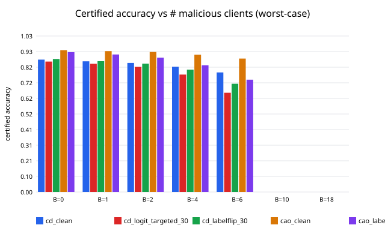

# certdistill

[](https://opensource.org/licenses/MIT)
[](https://www.python.org/downloads/)
[](https://github.com/habib-analyst/certdistill)

**The first certified Byzantine defense for federated learning where clients run different architectures** — with a provable bound: *"this prediction is unaffected by up to B malicious clients."*

## Quickstart

```bash
pip install certdistill
```

```python
from certdistill import CertDistill, stratified_subsets, ARCH_FAMILIES

# 60 clients, 3 architecture families (small CNN, deep CNN, MLP)
arch_of_client = [ARCH_FAMILIES[i % 3] for i in range(60)]
subsets = stratified_subsets(60, k=20, arch_of_client=arch_of_client, seed=0)

algo = CertDistill(
    client_data, arch_of_client, subsets, probe_X,   # probe_X: unlabeled public data
    alpha=1/3,            # trimmed-mean: exact median at 3 clients/subset
    rounds=4, tau=2.0,
    attack=None, malicious=[],                        # or e.g. attack="logit_targeted"
)
for r in algo.run():      # checkpoint after every round (resumable)
    print("round", r)
votes = algo.votes(X_test)                            # (K, N) vote matrix
```

## Measured results

MNIST · 60 clients (300 samples each) · 3 architecture families · K=20 subsets
· probe set 2000 · R=4 rounds. All numbers measured on CPU, seeds fixed.

| Attack (30% Byzantine) | Accuracy | Certified acc (B=6) | Certified acc (B=2) |
|---|---|---|---|
| clean | 0.8774 | 0.7899 | 0.8524 |
| label-flip | 0.8804 | 0.7149 | 0.8476 |
| logit-invert | 0.8770 | 0.7152 | 0.8437 |
| logit-targeted | 0.8623 | 0.6555 | 0.8261 |
| logit-random | 0.8765 | 0.7654 | 0.8443 |
| backdoor (trigger→0) | 0.8767 / ASR 0.10 | 0.7080 | 0.8427 |

Baselines (same setup): FedDF-mean 0.8743, FedRAD (median) 0.8730
(neither provides certificates),
Cao-homogeneous (certified, single architecture) 0.9393 / cert@B=6 0.8813 —
stronger, but inapplicable to heterogeneous clients.

**Honest certificate audit.** Worst-case certificates go vacuous at B≥10
with K=20 — that is a property of the threat model, shared with Cao et
al. The placement-conditional certificate (t = #subsets exceeding trimming
capacity; t=3 under 30% Byzantines vs B=18) stays meaningful at 0.80–0.83,
**10–15 points above** the worst-case bound. Without trimming (α=0),
t=10 and the conditional certificate is vacuous — the trimming is
load-bearing. Full margin histograms and the tight-vs-vacuous analysis are
in the [paper](paper/PAPER.md).

## How it works

Clients can't average weights — their architectures differ. So CertDistill
replaces weight averaging with **robust distillation**:

1. **Partition** clients into K disjoint subsets (stratified: one architecture
   family per subset member).
2. Each client trains locally (its own architecture), then sends **logits**
   on a public unlabeled probe set.
3. The server applies **α-trimmed-mean** per (sample, class) — with
   m=3, α=1/3 this is exactly the coordinate-wise median — and distills the
   robust targets into a subset student.
4. Final prediction = **majority vote** over the K students.

**The certificate (re-derived).** If a subset holds fewer Byzantines than the
trimming capacity (b_k ≤ α·m_k), its distilled targets stay within the honest
logit range (Lemma 1) — below-capacity attackers can perturb but not control.
Let t = #subsets exceeding capacity (t ≤ B always). Then a prediction with
vote margin n_a − n_b > 2t is provably unaffected by the Byzantine clients
(Theorem). Since t ≤ B, margin > 2B recovers Cao et al.'s bound — now shown
to be **architecture-agnostic**. The gap between the worst-case (B) and
placement-conditional (t) certificates is the distillation-tightening
contribution.



## Citation

```bibtex
@misc{rehman2026certdistill,
  author       = {Habib Ur Rehman},
  title        = {CertDistill: Certified Byzantine Robustness for
                  Model-Heterogeneous Federated Learning},
  year         = {2026},
  publisher    = {GitHub},
  url          = {https://github.com/habib-analyst/certdistill}
}
```

---
Built by [Habib Ur Rehman](https://github.com/habib-analyst) · ML/AI Engineer & healthcare-AI researcher ·
[LinkedIn](https://www.linkedin.com/in/hur-dev) · [habib.top](https://habib.top)
